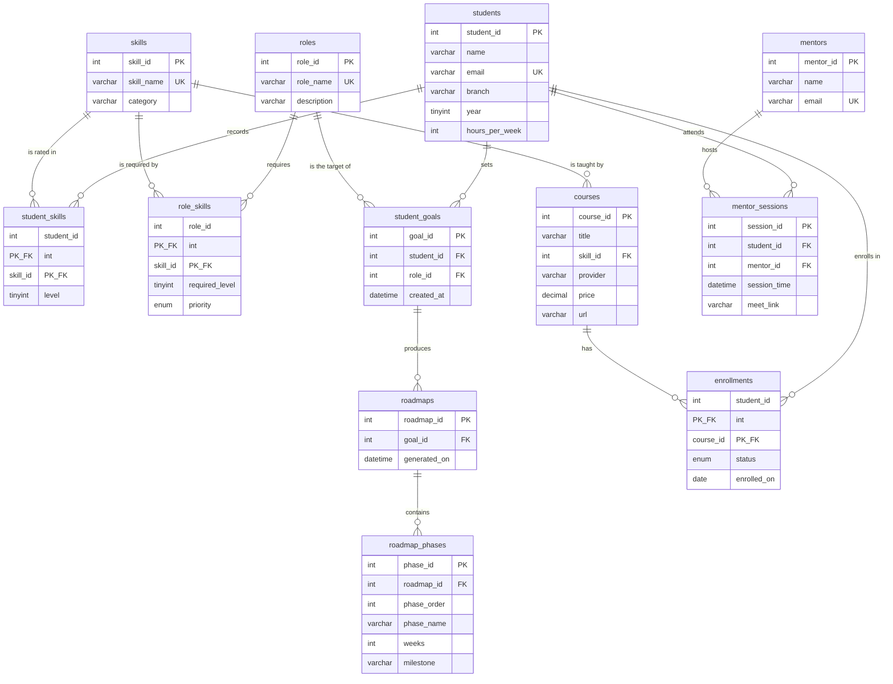

# CareerPilot entity-relationship diagram

Cardinality uses crow's foot notation. `||` is exactly one. `o{` is zero or many.

`student_skills`, `role_skills`, and `enrollments` are the associative tables for the three many-to-many relationships: student–skill, role–skill, and student–course.
